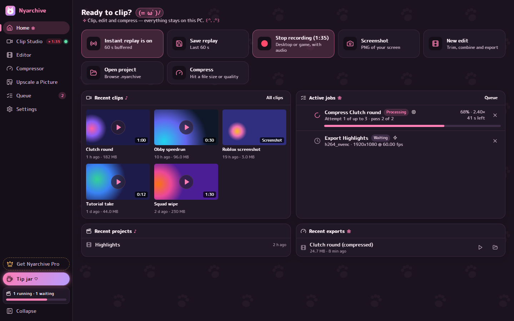
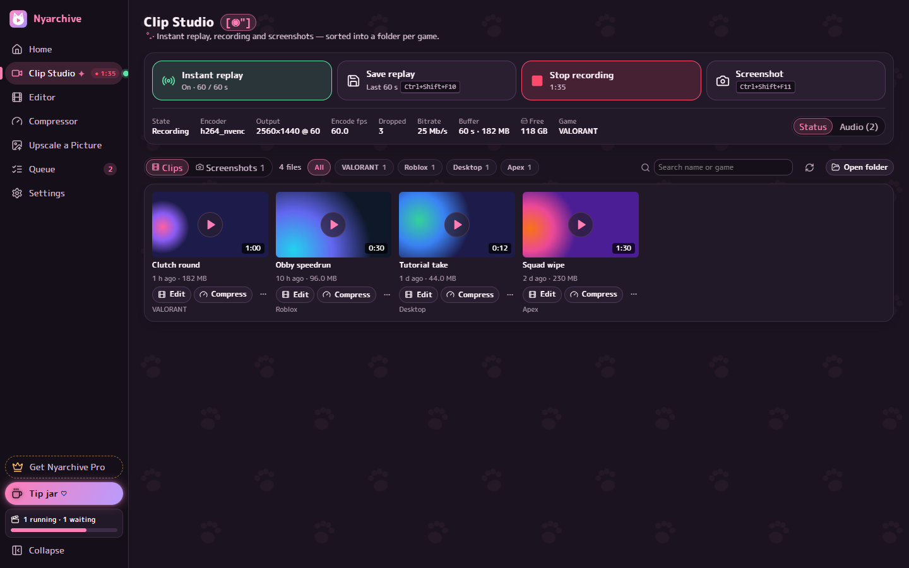
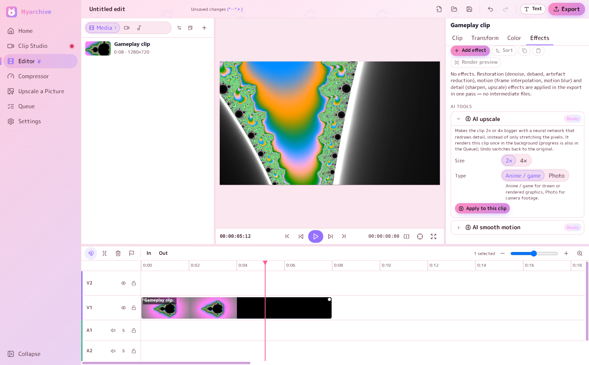
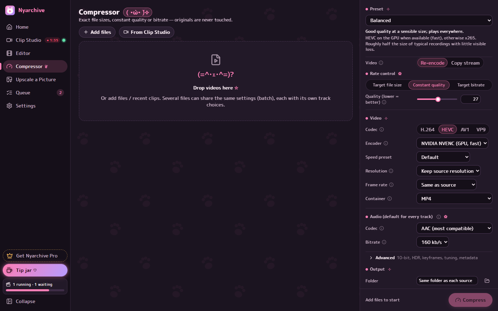
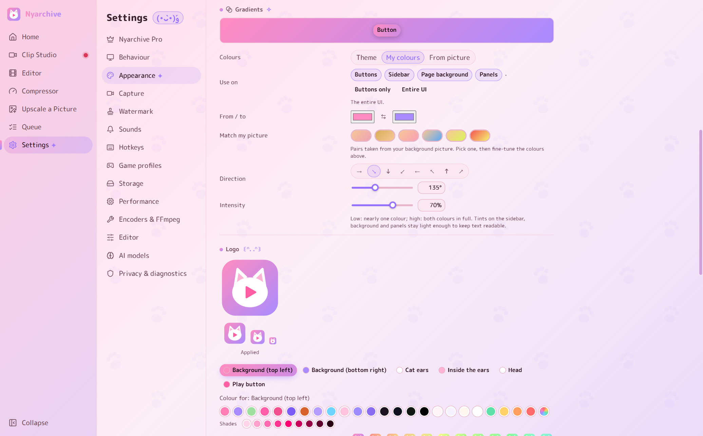

# Nyarchive

A cosy, catgirl-themed Windows app for clipping your gameplay, editing the clips and compressing them with minimal RAM or storage usage (=^･ω･^=). Everything happens on your PC: no account, no ads, no tracking and no cloud uploads.

**[Download the newest version](../../releases/latest)** (download `Nyarchive_x.y.z_x64-setup.exe`, then run it). Nyarchive updates itself after that.

## What it does
- **Clip Studio:** press a hotkey to save the last minutes of gameplay (instant replay), or record, or take screenshots. Game sound and your microphone are on separate tracks, and each game gets its own folder.
- **Editor:** cut clips on a multitrack timeline, then add text, music, fades, slow motion, colour and effects.
- **Compressor:** shrink videos to an exact size, for example under 10 MB for Discord.
- **AI tools:** sharpen and enlarge videos and pictures (Real-ESRGAN), or make motion smoother (RIFE).
- **Themes:** anime colour themes, or use your own picture as the background and Nyarchive matches the colours to it.

## Screenshots
| Clip Studio | Editor |
|---|---|
|  |  |
| **Compressor** | **Themes** |
|  |  |

## Installing
Run the downloaded `Nyarchive_x.y.z_x64-setup.exe`. Windows may show **"Windows protected your PC"**, because Nyarchive is new and not yet known to SmartScreen. Click **More info**, then **Run anyway**.

## Requirements
- Windows 10 or 11, 64-bit.
- FFmpeg: Nyarchive installs it for you with one click (Settings → Encoders & FFmpeg).
- For hardware encoding and the AI tools: an NVIDIA, AMD or Intel graphics card is recommended.

## Help and feedback
Found a bug or want a feature? [Open an issue](../../issues). In the app, Settings → Privacy & diagnostics → **Copy diagnostics** collects the details that help (your username and, if you choose, file names are hidden).

## Licence
Nyarchive is free to use, but it is not open source. See [EULA.txt](EULA.txt). The open-source parts it is built with are listed in [THIRD_PARTY_LICENSES.txt](THIRD_PARTY_LICENSES.txt) and [THIRD_PARTY_NOTICES.md](THIRD_PARTY_NOTICES.md).

Changes in each version: [CHANGELOG.md](CHANGELOG.md).
